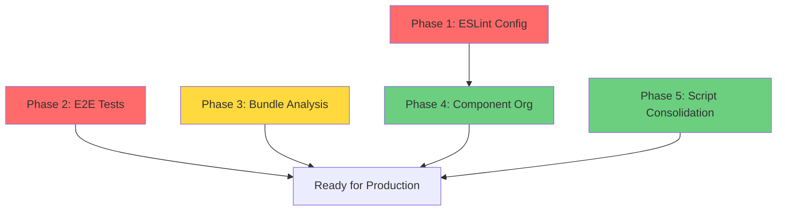

# Technical Debt Resolution Plan
**Created:** November 22, 2025
**Status:** Ready for Implementation
**Total Estimated Effort:** 17 tokens (~17 hours)

---

## Executive Summary

This plan addresses critical technical debt identified through automated verification. The primary focus is restoring broken tooling (ESLint, E2E tests, bundle analysis) before tackling organizational improvements. Each phase includes clear success criteria and can be implemented independently.

**Priority Order:**
1. **Phase 1** - ESLint Configuration (Critical for code quality)
2. **Phase 2** - E2E Test Infrastructure (Critical for deployment confidence)
3. **Phase 3** - Bundle Analysis (Important for performance monitoring)
4. **Phase 4** - Component Organization (Quality of life improvement)
5. **Phase 5** - Script Consolidation (Cleanup and maintainability)

---

## Phase 1: ESLint Configuration (CRITICAL)

**Priority:** 🔴 High
**Complexity:** 3 tokens
**Dependencies:** None
**Status:** Blocking code quality enforcement

### Problem Statement
- ESLint v9 is installed but has no configuration file
- `npm run lint` fails with: "ESLint couldn't find an eslint.config.(js|mjs|cjs) file"
- Zero linting rules are currently enforced
- Code quality cannot be validated before commits

### Success Criteria
- ✅ `npm run lint` runs without errors
- ✅ Linting enforces Next.js 15 + TypeScript best practices
- ✅ Pre-commit hooks can validate code quality
- ✅ CI/CD pipeline can run lint checks
- ✅ Common issues are caught: unused imports, type errors, accessibility violations

### Implementation Tasks

**1.1 Create ESLint Config** (1 token)
```bash
# Create: eslint.config.mjs
```

**Required rules:**
- Next.js 15 App Router conventions
- TypeScript strict mode support
- React 19 compatibility
- Accessibility (eslint-plugin-jsx-a11y)
- Tailwind CSS class ordering (eslint-plugin-tailwindcss)

**1.2 Verify Configuration** (0.5 tokens)
```bash
npm run lint                    # Should complete successfully
npm run lint -- --fix          # Auto-fix should work
```

**1.3 Document Linting Standards** (0.5 tokens)
- Add ESLint section to CLAUDE.md
- Document how to run linting locally
- Document auto-fix patterns

**1.4 Optional: Pre-commit Hook** (1 token)
- Install husky + lint-staged
- Run lint on staged files before commit
- Prevent broken code from being committed

### Verification Commands
```bash
# After implementation, run:
npm run lint                           # Should pass
npm run lint -- src/app/page.tsx      # Test single file
npm run build                          # Should still pass
```

### Acceptance Criteria
- [ ] `eslint.config.mjs` exists and is valid
- [ ] `npm run lint` completes without configuration errors
- [ ] All existing code passes linting (or has documented exceptions)
- [ ] Documentation updated in CLAUDE.md

---

## Phase 2: E2E Test Infrastructure (CRITICAL)

**Priority:** 🔴 High
**Complexity:** 3 tokens
**Dependencies:** None (can run parallel to Phase 1)
**Status:** Tests timeout waiting for dev server

### Problem Statement
- Playwright E2E tests timeout after 120 seconds
- Error: "Timed out waiting 120000ms from config.webServer"
- Dev server fails to start in test environment
- Cannot validate critical user flows before deployment

### Success Criteria
- ✅ `npm run test:e2e` completes successfully
- ✅ Dev server starts within 30 seconds in test mode
- ✅ All E2E tests pass (or failing tests are documented)
- ✅ E2E tests can run in CI/CD pipeline
- ✅ Visual regression tests work correctly

### Implementation Tasks

**2.1 Diagnose Timeout Issue** (1 token)
```bash
# Investigate:
cat playwright.config.ts              # Check webServer config
npm run dev                            # Verify dev server starts normally
lsof -i :3000                         # Check for port conflicts
```

**Likely causes:**
- Port 3000 already in use
- webServer timeout too short for cold starts
- Missing environment variables in test context
- Build/compile errors blocking startup

**2.2 Fix Configuration** (1 token)

**Option A: Increase timeout**
```typescript
// playwright.config.ts
webServer: {
  timeout: 180000, // Increase from 120s to 180s
}
```

**Option B: Use different port for tests**
```typescript
webServer: {
  command: 'npm run dev -- -p 3001',
  port: 3001,
}
```

**Option C: Pre-build before tests**
```typescript
webServer: {
  command: 'npm run build && npm run start',
  port: 3000,
  reuseExistingServer: !process.env.CI,
}
```

**2.3 Verify All Test Suites** (0.5 tokens)
```bash
npm run test:e2e              # Full E2E suite
npm run test:e2e:ui           # Interactive mode
npm run test:visual           # Visual regression
npm run test:styles           # Computed styles
```

**2.4 Update Test Documentation** (0.5 tokens)
- Document E2E test setup in /docs/testing-guide.md
- Add troubleshooting section for common issues
- Document how to update visual baselines

### Verification Commands
```bash
# After implementation, run:
npm run test:e2e              # Should complete in <60 seconds
npm run test:visual           # Should pass or show expected diffs
npm run test:refactor         # Full test suite should work
```

### Acceptance Criteria
- [ ] `npm run test:e2e` completes without timeout
- [ ] All E2E tests pass (or failures are documented)
- [ ] Visual regression tests work
- [ ] Tests documented in /docs/testing-guide.md

---

## Phase 3: Bundle Analysis (IMPORTANT)

**Priority:** 🟡 Medium
**Complexity:** 2 tokens
**Dependencies:** None
**Status:** Script missing, but mentioned in git history

### Problem Statement
- `npm run analyze` fails: "Missing script: analyze"
- File `bundle-analysis-output.txt` suggests script existed previously
- No visibility into bundle size or optimization opportunities
- Cannot track bundle size regressions

### Success Criteria
- ✅ `npm run analyze` generates bundle analysis report
- ✅ Can identify largest dependencies
- ✅ Can track bundle size over time
- ✅ Report is readable and actionable

### Implementation Tasks

**3.1 Install Bundle Analyzer** (0.5 tokens)
```bash
npm install --save-dev @next/bundle-analyzer
```

**3.2 Configure Analyzer** (0.5 tokens)
```javascript
// next.config.ts
import bundleAnalyzer from '@next/bundle-analyzer';

const withBundleAnalyzer = bundleAnalyzer({
  enabled: process.env.ANALYZE === 'true',
});

export default withBundleAnalyzer(nextConfig);
```

**3.3 Add Scripts** (0.5 tokens)
```json
// package.json
{
  "scripts": {
    "analyze": "ANALYZE=true npm run build",
    "analyze:browser": "ANALYZE=true npm run build && open .next/analyze/client.html"
  }
}
```

**3.4 Create Baseline Report** (0.5 tokens)
```bash
npm run analyze > docs/bundle-analysis-baseline-2025-11-22.txt
```

### Verification Commands
```bash
# After implementation, run:
npm run analyze               # Should generate analysis
open .next/analyze/client.html # Should show interactive report
```

### Acceptance Criteria
- [ ] `npm run analyze` script exists and works
- [ ] Bundle analysis report is generated
- [ ] Baseline report saved to /docs
- [ ] Can identify top 10 largest dependencies

---

## Phase 4: Component Organization (QUALITY OF LIFE)

**Priority:** 🟢 Low
**Complexity:** 5 tokens
**Dependencies:** Phase 1 (ESLint should be working to catch broken imports)
**Status:** 131 items in src/components with mixed structure

### Problem Statement
- 131 items in `src/components` with mixed organization
- Layout components (Footer, ContactForm) at root level
- Multiple case study folders: `case-studies`, `case-study-editorial`, `case-study-flowing`
- Hard to find components and understand feature boundaries
- No clear convention for new components

### Success Criteria
- ✅ Logical grouping: layout/, features/, case-studies/
- ✅ Reduced cognitive load when finding components
- ✅ Clear patterns for adding new components
- ✅ No broken imports after reorganization
- ✅ All tests still pass

### Implementation Tasks

**4.1 Audit Current Structure** (1 token)
```bash
# Create inventory:
ls -la src/components/ > docs/component-inventory-before.txt

# Categorize components:
# - Layout components (Footer, ContactForm, ContactSection)
# - UI library (ui/)
# - Case study components (3 folders + related files)
# - Feature-specific (chatbot/, navigation/, providers/)
# - Standalone utilities (FaviconGenerator, GoogleAnalytics)
```

**4.2 Plan Reorganization** (1 token)

**Proposed structure:**
```
src/components/
├── ui/                    # shadcn/ui components (keep as-is)
├── layout/               # NEW: Site-wide layout
│   ├── Footer.tsx
│   ├── ContactForm.tsx
│   └── ContactSection.tsx
├── features/             # NEW: Feature-specific
│   ├── chatbot/
│   ├── navigation/
│   └── case-studies/    # CONSOLIDATED
│       ├── shared/      # Shared components
│       ├── editorial/   # Editorial layout
│       ├── flowing/     # Flowing layout
│       └── narrative/   # Narrative components
├── providers/           # Keep as-is
└── utilities/           # NEW: Standalone utils
    ├── FaviconGenerator.tsx
    └── GoogleAnalytics.tsx
```

**4.3 Create Migration Script** (1 token)
```typescript
// scripts/reorganize-components.ts
// Automate moving files and updating imports
```

**4.4 Execute Reorganization** (1 token)
```bash
npm run reorganize-components    # Run migration
npm run build                    # Verify no broken imports
npm run test                     # Verify tests still pass
```

**4.5 Update Documentation** (1 token)
```markdown
# Update CLAUDE.md with new structure
# Create /docs/component-organization-guide.md
# Document naming conventions and patterns
```

### Verification Commands
```bash
# After implementation, run:
npm run build                    # Should build successfully
npm run test                     # All tests should pass
npm run lint                     # No import errors
git diff --name-only            # Review all moved files
```

### Acceptance Criteria
- [ ] Components organized into logical folders
- [ ] All imports updated (no broken references)
- [ ] Build and tests pass
- [ ] Documentation updated
- [ ] Git history preserved (use `git mv`)

---

## Phase 5: Script Consolidation (CLEANUP)

**Priority:** 🟢 Low
**Complexity:** 4 tokens
**Dependencies:** None
**Status:** Scripts split between root and src/scripts

### Problem Statement
- Migration scripts in both `scripts/` and `src/scripts/`
- Many one-off scripts that may no longer be needed:
  - `migrate-virgin-america.ts`
  - `migrate-aesop-lyft.ts`
  - Various import scripts
- Unclear which scripts are still active vs historical
- No documentation on what each script does

### Success Criteria
- ✅ Single location for scripts (src/scripts/)
- ✅ Clear separation: active scripts vs archived scripts
- ✅ Documentation of what each script does
- ✅ Reduced clutter in root directory

### Implementation Tasks

**5.1 Inventory All Scripts** (1 token)
```bash
# List all scripts:
find scripts/ src/scripts/ -name "*.ts" -o -name "*.mjs" > docs/script-inventory.txt

# Categorize:
# - Active (referenced in package.json or docs)
# - Migration (one-off, likely historical)
# - Utilities (reusable tools)
```

**5.2 Identify Active Scripts** (1 token)
```bash
# Check package.json references:
cat package.json | grep -E "scripts/|src/scripts/"

# Active scripts (from package.json):
# - scripts/migrate-about-content.ts
# - scripts/migrate-about-content-v2.ts
# - scripts/migrate-footer-content.ts
# - scripts/migrate-profile-to-article.ts
# - scripts/import-showcases/*.ts
# - scripts/update-featured-fields.ts
# - scripts/migrations/migrate-to-editorial.ts
# - scripts/debug-sanity-images.ts
```

**5.3 Archive Historical Scripts** (1 token)
```bash
# Create archive:
mkdir -p scripts/archive/migrations-2025

# Move one-off migrations:
git mv scripts/migrate-virgin-america.ts scripts/archive/migrations-2025/
git mv scripts/migrate-aesop-lyft.ts scripts/archive/migrations-2025/

# Document why archived:
echo "# Archived Scripts - 2025-11-22" > scripts/archive/migrations-2025/README.md
```

**5.4 Consolidate to src/scripts** (0.5 tokens)
```bash
# Move active scripts:
git mv scripts/* src/scripts/

# Update package.json paths:
# "migrate:about": "tsx src/scripts/migrate-about-content.ts"
```

**5.5 Document Scripts** (0.5 tokens)
```markdown
# Create /docs/scripts-reference.md
# Document each active script:
# - Purpose
# - When to use
# - Example usage
# - Dependencies
```

### Verification Commands
```bash
# After implementation, run:
npm run migrate:about            # Test script still works
npm run import:showcases         # Test import scripts
ls scripts/                      # Should be empty or minimal
ls src/scripts/                  # Should contain all active scripts
```

### Acceptance Criteria
- [ ] All active scripts in src/scripts/
- [ ] Historical scripts archived with documentation
- [ ] package.json scripts updated with correct paths
- [ ] /docs/scripts-reference.md created
- [ ] All script commands in package.json still work

---

## Implementation Order & Dependencies



**Recommended Sequence:**
1. **Week 1:** Phase 1 (ESLint) + Phase 2 (E2E Tests) - Critical tooling
2. **Week 2:** Phase 3 (Bundle Analysis) - Important monitoring
3. **Week 3:** Phase 4 (Component Org) - Quality of life
4. **Week 4:** Phase 5 (Script Cleanup) - Maintenance

**Parallel Execution Options:**
- Phase 1 + Phase 2 can run in parallel (no dependencies)
- Phase 3 + Phase 5 can run in parallel (no dependencies)
- Phase 4 should wait for Phase 1 (need linting to catch import errors)

---

## Risk Assessment

### High Risk
- **Phase 4 (Component Org):** Could break imports if not careful
  - **Mitigation:** Create automated migration script, run full test suite

### Medium Risk
- **Phase 2 (E2E Tests):** Root cause of timeout is unknown
  - **Mitigation:** Investigate thoroughly before implementing fix

### Low Risk
- **Phase 1, 3, 5:** Additive changes with minimal impact on existing code

---

## Success Metrics

### Overall Project Health
- ✅ All automated checks pass: lint, test, test:e2e, build
- ✅ Code quality is enforced automatically
- ✅ Bundle size is monitored and tracked
- ✅ Component organization is logical and documented
- ✅ Scripts are organized and well-documented

### Phase-Specific Metrics
| Phase | Metric | Target |
|-------|--------|--------|
| 1 - ESLint | `npm run lint` success rate | 100% |
| 2 - E2E Tests | Test completion time | <60 seconds |
| 2 - E2E Tests | Test pass rate | 100% (or documented failures) |
| 3 - Bundle Analysis | Analysis generation time | <5 minutes |
| 4 - Component Org | Build time impact | <10% increase |
| 5 - Scripts | Active scripts count | <15 |

---

## Rollback Plan

### If Phase 1 (ESLint) Breaks Build
```bash
# Remove strict rules temporarily
git checkout HEAD~1 eslint.config.mjs
npm run build
```

### If Phase 2 (E2E) Tests Still Fail
```bash
# Increase timeout as temporary fix
# Update playwright.config.ts: timeout: 300000
# File issue for further investigation
```

### If Phase 4 (Component Org) Breaks Imports
```bash
# Revert all moves
git reset --hard HEAD~1
npm run build  # Verify clean state
```

### If Phase 5 (Script Consolidation) Breaks Commands
```bash
# Revert package.json changes
git checkout HEAD~1 package.json
# Verify all scripts work
npm run migrate:about  # Test example
```

---

## Post-Implementation Checklist

After completing all phases:

- [ ] All verification commands pass
- [ ] Documentation updated:
  - [ ] CLAUDE.md reflects new ESLint setup
  - [ ] /docs/testing-guide.md documents E2E tests
  - [ ] /docs/component-organization-guide.md created
  - [ ] /docs/scripts-reference.md created
- [ ] Baseline reports created:
  - [ ] /docs/bundle-analysis-baseline-2025-11-22.txt
  - [ ] /docs/component-inventory-before.txt
  - [ ] /docs/component-inventory-after.txt
- [ ] CI/CD updated (if applicable):
  - [ ] Lint checks run on PRs
  - [ ] E2E tests run on PRs
  - [ ] Bundle analysis runs weekly
- [ ] Team communication:
  - [ ] Notify team of new linting rules
  - [ ] Document new component organization patterns
  - [ ] Share script consolidation changes

---

## Related Documentation

- [Technical Audit Report](../technical_audit_2025-11-22.md) - Original audit findings
- [Google Analytics Test Traffic Filtering Research](./google-analytics-test-traffic-filtering-research.md) - Related research
- [CSS Phase 4-8 Completion](./css-remaining-enhancements-plan.md) - Recent improvements
- [Component Styling Patterns](./component-styling-patterns.md) - Current best practices
- [Animation System](./animation-system.md) - Styling utilities

---

## Questions & Clarifications

Before starting implementation:

1. **ESLint:** Do you want strict rules or gradual adoption with warnings first?
2. **E2E Tests:** Should we investigate timeout or just increase the limit?
3. **Component Org:** Do you want to preserve git history with `git mv` or clean slate?
4. **Scripts:** Should archived scripts be deleted or kept in archive folder?
5. **Timeline:** Is there a deadline, or should we proceed phase by phase with reviews?

---

**Next Steps:**
1. Review this plan and provide feedback
2. Answer clarifying questions above
3. Get approval to proceed with Phase 1 (ESLint)
4. Execute phases sequentially with verification at each step
